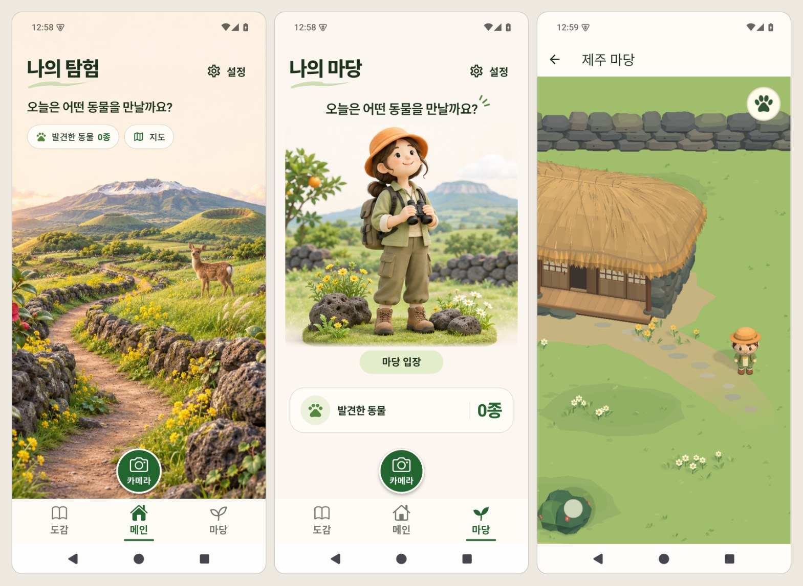

# Jeju-project

[동물 도감](https://jeju-wildlife-field-guide.gimhoyeon.chatgpt.site/) · [제주 관찰 지도](https://jeju-wildlife-field-guide.gimhoyeon.chatgpt.site/map)

제주 AI 에이전트 공모전 팀의 Flutter 앱입니다.

## 로컬 실행

팀원은 GitHub 초대를 수락한 계정으로 아래 명령을 실행하세요. 이 프로젝트에서 사용한 Flutter 버전은 `3.47.9`입니다.

```sh
git clone -b feat/on-device-identification https://github.com/HighDpsHotCat/Jeju-project.git
cd Jeju-project
python tool/prepare_identification.py
python tool/prepare_identification.py
flutter pub get
flutter run
```

기본 위젯 테스트는 `flutter test`로 실행합니다.

## 카메라로 동물 식별하기

**카메라 → 사진 촬영 → 셔터 누르기**로 노루, 참새, 칠성무당벌레, 붉은귀거북, 청개구리 한 마리를 찍으면 앱이 사진의 픽셀로 동물군과 종을 추정합니다. **갤러리 사진으로 식별**도 같은 모델을 사용합니다. 후보를 누르면 도감 상세를 볼 수 있고 **이 종으로 확인** 또는 **미확인으로 두기**를 선택할 수 있습니다. 사진과 GPS는 기기에 남습니다.

**현장 기록 저장**을 누르면 그 시점의 AI 결과도 함께 저장합니다. 기록을 다시 열어 **다시 식별**하거나 후보를 정정한 뒤에는 **식별 결과 저장**을 누르세요. 갤러리와 웹에서 연 사진은 식별 시연에만 사용합니다. 휴대폰 없이 시험하려면 `python tool/prepare_identification.py --web`과 `flutter run -d chrome`을 차례대로 실행하고 **카메라 → 사진 열기**를 누르세요.

특징 추출 모델은 첫 빌드 전에 체크섬을 검증해 받습니다. Android 앱에는 모델을 포함하므로 설치 후 식별에는 인터넷이 필요 없습니다. [학습·평가 방법과 종별 결과](docs/AI_IDENTIFICATION_RESULTS.md)

## 마당과 동물 도감

앱을 열면 **메인** 탭이 표시됩니다. 가운데 초록색 **카메라**를 눌러 촬영하고, **마당 → 마당 입장**을 누르면 앱 안에서 Unity의 제주 마당을 열 수 있습니다. 휴대폰과 Mac 앱, 웹 버전에 플레이어가 포함됩니다. 초가집의 **마당 나가기**나 상단 뒤로가기를 누르면 마당 탭으로 돌아옵니다. 탐험가 이름은 **설정 → 나의 캐릭터**에서 바꿉니다.

메인의 **지도**에서 브라우저로 공유 관찰 지도를 엽니다. 도감 상세의 **제주 관찰 장소 보기**는 해당 종의 공유 도감으로 연결됩니다.



마당 하단의 **도감**에서 우측 상단 메뉴로 목록을 전환합니다. 기본 **제주 목격 생물**은 제주 종 기준표의 원자료 관찰 건수가 1건 이상인 4,875종입니다. **전국 도감**은 2025년 국가생물종목록에 등재된 동물 34,875종을 해당 목록의 국명·학명·분류로 표시합니다. 전환해도 검색어와 분류 선택은 유지되며, 발견한 동물 수는 선택한 목록 기준입니다. 두 자료의 학명·국명이 유일하게 대조된 종은 같은 발견 기록을 사용합니다. 원자료를 갱신할 때는 Python 환경에 `openpyxl`을 설치하고 `python3 tool/build_guide_catalog.py`를 실행하세요.

**설정 → 예시 기록 보기**를 켜면 12종이 등록된 시안을 체험할 수 있습니다. 기본 화면은 기기 기록을 표시합니다. 모바일 앱은 SQLite 데이터베이스 디렉터리의 `jeju_catalog.sqlite3`에서 `species_card` 뷰를 읽습니다. `device_profile.user_id` 환경설정 값이 있으면 그 사용자를, 없으면 기기의 단일 프로필을 사용합니다.

도감에서 종을 검색하고 **직접 관찰한 동물로 등록**을 누르면 현재 프로필의 수동 관찰 기록에 저장합니다. 마당에서 개는 웰시코기, 고양이는 노란 고양이로 나타납니다. 갈매기·참새·호랑나비·남방큰돌고래도 3D 모델이 있습니다.

수동 관찰은 **처음 만난 날짜**와 선택한 **시·읍·면·동**을 저장합니다. 확인된 기기 관찰은 현재 프로필에서 같은 종을 처음 촬영한 시각을 제주 날짜로 바꾸고 그때의 좌표를 기기에 포함된 제주 행정동 경계와 대조합니다. 마당으로 보내는 정보는 날짜와 행정구역명입니다. 예전 등록에 첫 관찰 정보가 없거나 바다·경계선에서 구역을 정할 수 없으면 해당 항목은 **기록 없음**으로 표시합니다. [행정동 경계 자료와 출처](assets/catalog/jeju_districts_credit.txt)

**마당 입장**으로 들어가면 현재 프로필의 도감이 전달됩니다. 마당 오른쪽 위 발바닥을 눌러 등록 목록을 볼 수 있습니다. 별도의 Mac Unity 실행판은 Flutter가 시작·복귀·등록 시 저장한 로컬 파일을 읽습니다. 모바일에서 두 앱을 따로 실행할 때는 Flutter 도감의 **마당으로 보내기**로 복사한 후 Unity 발바닥 메뉴의 **도감 불러오기**를 누르세요. 동물 카드를 누르면 큰 3D 모델, 처음 만난 날짜와 장소, **초대하기** 또는 **내보내기** 버튼이 나타납니다. 실제 기록과 예시 기록의 마당 배치도 따로 저장합니다.

마당 씬을 수정한 뒤에는 Unity 6000.4.4f1의 Web Build Support를 설치하고 `unity/JejuYard`를 열어 **Jeju Yard → Build Flutter yard player**를 실행하세요. 이 메뉴가 앱에 포함되는 `assets/yard/player.js`를 갱신합니다.

Mac에서 Xcode 없이 시연하려면 `flutter build web --no-web-resources-cdn`으로 빌드하고 `python3 -m http.server 8765 --bind 127.0.0.1 --directory build/web`을 실행하세요. 브라우저에서 `http://localhost:8765`를 열면 로컬 도감과 클립보드 전송을 사용할 수 있습니다. 웹에서 직접 등록한 기록은 해당 브라우저에 저장됩니다. 웹 빌드는 로컬 CanvasKit과 한글 글꼴을 포함합니다. 한글 글꼴은 나눔고딕에서 추출했으며 라이선스는 `assets/web_fonts/OFL.txt`에 있습니다.

## 공유 웹 도감과 관찰 지도

공유 웹 화면의 원본은 `field_guide/`에 있습니다. 저장소 루트에서 `python field_guide/preview.py`를 실행하고 `http://127.0.0.1:8787`을 열면 현재 CSV와 앱의 전국 종 색인으로 확인할 수 있습니다. 탐험 설정에서 예시 기록을 켤 수 있습니다. 웹에서 선택한 사진은 해당 브라우저에서만 미리 봅니다.

앱 마당의 **관찰 지도**에서 같은 지도를 엽니다. **탐방 장소**에서 화면에서 가까운 장소는 원형 숫자 핀으로 묶입니다. 숫자를 누르면 그 위치를 확대하고, 떨어진 장소는 이름을 표시합니다. 상세 배율에서는 주변 GBIF 관찰 동물을 볼 수 있으며 마지막 배율에서도 겹치는 장소는 숫자를 눌러 목록에서 고릅니다. 확대·축소 버튼, 마우스 휠, 두 손가락 벌리기·오므리기를 사용할 수 있습니다. 탐방지 핀을 누르면 반경 2km의 GBIF 관찰 표본을 확인할 수 있습니다. 동물 이름을 누르면 해당 종의 도감이 열립니다. 지도 설정에서 제주시·서귀포시 관광지 목록도 열 수 있습니다. 서식 기록 지도 역시 핀과 이름을 차례로 누르는 방식입니다. 첨부된 VISIT JEJU 여행장소 CSV의 이름을 공식 관광 정보에 대조해 한라수목원, 천지연폭포, 제주곶자왈도립공원, 광치기해변을 추가했습니다. 여기에 VISIT JEJU 여행장소 CSV에서 고른 해수욕장·폭포·오름·계곡 등 43곳을 더해 총 53곳입니다. 추가 장소의 좌표와 주소는 `field_guide/visit-jeju.json`에 있습니다. 같은 이름이 여러 번 나오면 공백을 정리한 뒤 위도·경도 중앙값에 가장 가까운 원본 행을 사용했습니다. 관광지 대표 좌표와 실제 방문자 입구를 구분하며, 현장 사진 관찰·서식 자료·보호 사육 기록의 구분을 동물별로 표시합니다.

**서식 기록**은 7개 권역의 문헌 출처와 관련 동물을 보여줍니다. **관찰 기록**은 날짜가 있는 GBIF 기록을 행정시·종별로 볼 수 있습니다. 동물 이름을 누르면 제주 또는 전국 도감의 해당 종 카드가 열립니다. 도감 카드에서도 연결된 장소와 기록으로 돌아갈 수 있습니다. 생태·자연도는 지도 설정에서 선택해 겹쳐 봅니다. 관광지 사진의 저작자·원본·이용허락 링크는 지도 화면에서 확인할 수 있습니다.

장소와 서식 자료의 출처는 `field_guide/map-data.js`에 있습니다. 관찰 자료는 백엔드 브랜치 `feat/3-api-species-lookup`의 `backend/data/region_grade_records.csv`를 사용합니다. 갱신하려면 이 브랜치의 루트에서 `python tool/build_map_records.py <CSV경로>`를 실행하세요. 공개 자료에는 행정시, 종, 날짜, GBIF 원문 ID, 데이터셋, 제공자 및 이용허락을 포함합니다.

공유 도감의 GBIF 제주 관찰 표본은 `python tool/collect_gbif.py`로 갱신합니다. 제주 GADM 경계의 좌표가 있는 사람 관찰 중 CC0·CC BY 4.0 자료를 최대 900건 조회하고, 도감에서 학명이 유일하게 일치하는 기록만 종 카드에 연결합니다. 표본 수와 기존 원자료 관찰 건수는 별도로 표시합니다.

주변 관찰은 `python tool/collect_nearby.py`로 갱신합니다. 장소별 주변 검색 결과 최대 900건에서 관찰 좌표까지의 대권거리와 보고된 위치 오차의 합이 2km 이내인 자료를 골라 종별 최신 표본을 표시합니다. 날짜와 거리는 같은 관찰 건의 값입니다.
**현장 촬영(Android·iOS)**: 하단 카메라 → 사진 촬영 → 위치 측정 상태 확인 → 셔터 누르기 → 미리보기 → 현장 기록 저장. 저장한 사진과 측정값은 카메라 화면의 **저장한 현장 기록**에서 다시 열 수 있습니다.

촬영 시각은 앱에서 셔터를 누른 UTC 시각이고, GPS 측정 시각은 기기가 제공한 위치값의 시각입니다. 셔터 이후 수신된 위치는 그 사진에 사용하지 않습니다. 두 시각, 위도·경도, 수평 정확도(m)를 사진과 함께 앱 전용 폴더 `field_captures/<photo_id>/`에 기록합니다. 화면에서는 기기의 현지 시각으로 표시합니다.

위치 권한 거부·서비스 꺼짐·측정 전에는 사진과 촬영 시각을 저장하며 좌표는 비워 둡니다. 셔터보다 15초 넘게 오래된 값 또는 미래 시각의 값은 측정 시각 차이가 있다고 표시합니다. 15초는 미리보기의 임시 신선도 기준입니다. 현장 사진의 종 확인은 그 기록에만 저장되고 개인 도감 수집 수는 그대로 유지됩니다.

iOS에서 Swift Package Manager로 빌드할 때는 `BYPASS_PERMISSION_LOCATION_ALWAYS=1 flutter build ios`로 앱 사용 중 위치 권한만 사용합니다.
