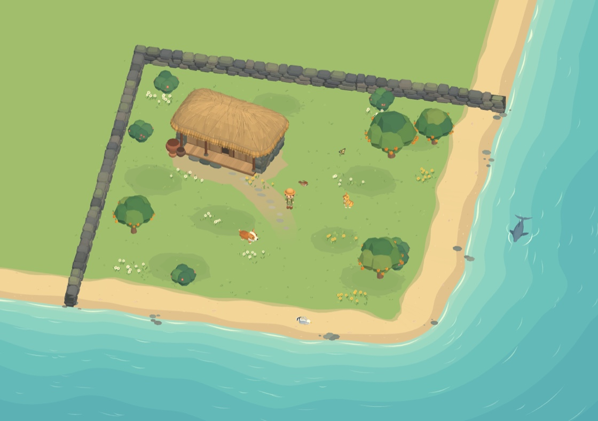

# 제주 바닷가 마당

Unity 6000.4.4f1로 만든 1인용 로우폴리 마당입니다. Unity Hub에서 이 폴더를 프로젝트로 추가하고 `Assets/Scenes/JejuYard.unity`를 열어 Play를 누르세요.

- **이동** · 맥에서는 WASD 또는 방향키를 씁니다. 터치 화면에서는 화면 아래쪽을 누른 뒤 원하는 방향으로 끕니다. 맥에서도 마우스 드래그로 같은 조작을 시험할 수 있습니다.
- **동물 만나기** · 초대한 동물 가까이 가면 웰시코기와 고양이는 캐릭터 쪽으로 돌아앉고, 새는 날개를 접고 내려앉습니다. 호랑나비는 꽃에 앉고 돌고래는 바다에서 캐릭터를 바라봅니다. 화면 오른쪽 중하단의 하늘색 체크 버튼을 눌러 모델과 첫 만남 기록을 보고, ×를 눌러 마당으로 돌아오세요.
- **마당 나가기** · 초가집 가까이에 가면 지붕에 **마당 나가기** 말풍선이 뜹니다. 말풍선을 누르거나, 초가집이 가장 가까운 대상일 때 체크 버튼을 누르면 나갑니다. 맥 실행판은 게임 창을 닫고 Unity 에디터는 Play를 종료합니다. 독립 실행형 모바일에서는 홈 화면의 **마당으로 돌아가기**로 다시 들어올 수 있습니다.
- **거리** · 마당 중앙에서 최대 속도(1.8m/s)로 약 7초 걸으면 위쪽과 왼쪽에서는 현무암 돌담에, 오른쪽과 아래쪽에서는 모래사장 끝 물가에 닿습니다. 조이스틱을 조금만 밀면 천천히 걷습니다.
- **마당 도감** · 오른쪽 위 발바닥을 누른 뒤 동물 카드를 선택하세요. 큰 3D 모델 아래에 이름, 처음 만난 날, 만난 위치가 차례로 나옵니다. 위치는 시와 동 단위까지 표시하며 읍·면 지역은 읍·면까지 표시합니다. **초대하기**를 누르면 동물이 마당에 나타나고 **내보내기**를 누르면 도감 등록을 유지한 채 마당에서만 사라집니다. 오른쪽 위 ×를 누르면 보던 목록으로 돌아갑니다. 배치는 기기에 프로필별로 저장됩니다.
- **도감 연결** · 같은 맥에서 Flutter 도감을 사용하면 Unity가 앱의 로컬 목록을 읽습니다. 별도로 설치한 모바일 시연 앱에서는 Flutter 도감의 **마당으로 보내기**를 누른 뒤 Unity 발바닥 메뉴의 **도감 불러오기**를 누르세요. Unity만 먼저 실행한 경우 **시연 도감 보기**로 여섯 모델을 체험할 수 있습니다.
- **바닷가** · 모래사장은 오른쪽에서 아래쪽까지 이어집니다. 남방큰돌고래를 들인 뒤 물가에서 기다리면 헤엄치다가 수면 위로 뛰어오르는 모습을 볼 수 있습니다.
- **마당 동물** · 짧은 다리의 웰시코기가 잔디밭을 산책합니다. 노란 줄무늬 고양이는 주로 앉아서 쉬다가 가끔 한 바퀴 걷습니다. 참새는 중앙 풀밭에, 갈매기는 남쪽 모래사장에 날개를 접고 앉아 있다가 다시 날아오릅니다. 오른쪽 꽃밭에서는 호랑나비를 볼 수 있습니다. Unity의 Hierarchy에서 `Yard animals`를 펼치면 다섯 동물을 한 마리씩 선택해 옮길 수 있습니다.
- **모바일 구성** · 정사영 카메라가 화면 비율에 따라 거리를 조절합니다. 지붕의 볏짚, 목재 창호, 돌담과 탐험가의 색은 메시 정점에 저장했고, 씬 전체가 재질 하나를 공유합니다. 모델과 장면은 프로젝트에 포함됩니다.
- **편집과 검증** · 씬에서 집, 돌담, 나무, 캐릭터를 선택해 편집할 수 있습니다. `Jeju Yard → Check walking distances`는 실제 캐릭터 컨트롤러로 네 방향의 충돌 시간을 30Hz와 60Hz에서 검사합니다. `Rebuild courtyard from authored models`는 제작 코드에서 씬과 메시를 다시 생성해 수동 편집을 교체합니다.

