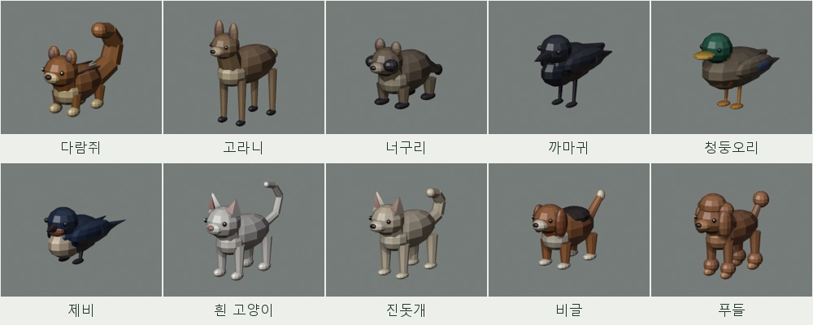

# 제주 바닷가 마당

Unity 6000.4.4f1로 만든 1인용 로우폴리 마당입니다. Unity Hub에서 이 폴더를 프로젝트로 추가하고 `Assets/Scenes/JejuYard.unity`를 열어 Play를 누르세요.

- **이동** · 맥에서는 WASD 또는 방향키를 씁니다. 터치 화면에서는 화면 아래쪽을 누른 뒤 원하는 방향으로 끕니다. 맥에서도 마우스 드래그로 같은 조작을 시험할 수 있습니다.
- **동물 만나기** · 초대한 동물에게 가까이 가서 하늘색 체크 버튼을 누르면 말풍선이 뜹니다. 위아래 버튼으로 고른 뒤 체크하거나 말풍선을 바로 누르세요. **꾸미기**에서는 웰시코기, 노란 고양이, 갈매기, 참새, 돌고래에게 별 머리띠와 작은 빨간 망토를 각각 입힐 수 있습니다. 착용한 장식을 다시 누르면 벗습니다. 나비에게는 **정보**와 **쓰다듬기**가 나타납니다.
- **쓰다듬기와 호감도** · 동물은 쓰다듬을 때마다 반응합니다. 첫 쓰다듬기에서 하트 한 칸(5점)을 얻고, 그 동물의 점수가 오른 시점부터 6시간이 지나면 다음 쓰다듬기에서 한 칸 더 얻습니다. 정보 창에서 첫 만남 기록과 하트 20칸(최대 100점)을 확인할 수 있습니다. 호감도 옆의 작은 **?**를 누르면 다음 적립까지 남은 시간이 보이고 다시 누르면 접힙니다. 호감도는 기기에 저장됩니다.
- **초가집** · 집에 가까이 가서 오른쪽 체크 버튼을 누르면 **옷 꾸미기**와 **마당 나가기** 말풍선이 세로로 열립니다. 위아래 화살표로 고른 뒤 체크를 다시 누르거나 말풍선을 직접 누르세요. 집에서 멀어지면 메뉴가 닫힙니다. 옷장에서 상의와 모자를 따로 누르면 3D 미리보기와 마당의 캐릭터에 바로 반영됩니다. 기본 탐험복으로 돌아가려면 각 탭에서 기본 아이템을 고르세요. **마당 나가기**는 맥 실행판의 게임 창을 닫고 Unity 에디터에서는 Play를 종료합니다. 독립 실행형 모바일에서는 홈의 **마당으로 돌아가기**로 다시 들어올 수 있습니다.
- **거리** · 마당 중앙에서 최대 속도(3.6m/s)로 약 3.5초 걸으면 위쪽과 왼쪽에서는 현무암 돌담에, 오른쪽과 아래쪽에서는 모래사장 끝 물가에 닿습니다. 조이스틱을 조금만 밀면 천천히 걷습니다.
- **마당 도감** · 오른쪽 위 발바닥을 누른 뒤 동물 카드를 선택하세요. 큰 3D 모델 아래에 이름, 처음 만난 날, 만난 위치가 차례로 나옵니다. 위치는 시와 동 단위까지 표시하며 읍·면 지역은 읍·면까지 표시합니다. **초대하기**를 누르면 동물이 마당에 나타나고 **내보내기**를 누르면 도감 등록을 유지한 채 마당에서만 사라집니다. 오른쪽 위 ×를 누르면 보던 목록으로 돌아갑니다. 배치는 기기에 프로필별로 저장됩니다.
- **도감 연결** · 같은 맥에서 Flutter 도감을 사용하면 Unity가 앱의 로컬 목록을 읽습니다. 별도로 설치한 모바일 시연 앱에서는 Flutter 도감의 **마당으로 보내기**를 누른 뒤 Unity 발바닥 메뉴의 **도감 불러오기**를 누르세요. Unity만 먼저 실행한 경우 **시연 도감 보기**에서 마당 모델을 체험할 수 있습니다.
- **바닷가** · 모래사장은 오른쪽에서 아래쪽까지 이어집니다. 남방큰돌고래를 들인 뒤 물가에서 기다리면 헤엄치다가 수면 위로 뛰어오르는 모습을 볼 수 있습니다.
- **마당 동물** · 짧은 다리의 웰시코기가 잔디밭을 산책합니다. 노란 줄무늬 고양이는 주로 앉아서 쉬다가 가끔 한 바퀴 걷습니다. 참새는 중앙 풀밭에, 갈매기는 남쪽 모래사장에 날개를 접고 앉아 있다가 다시 날아오릅니다. 오른쪽 꽃밭에서는 호랑나비를 볼 수 있습니다. Unity의 Hierarchy에서 `Yard animals`를 펼치면 다섯 동물을 한 마리씩 선택해 옮길 수 있습니다.
- **추가 동물** · 다람쥐, 고라니, 너구리, 까마귀, 청둥오리, 제비를 도감 등록 후 초대할 수 있습니다. 고라니와 너구리는 전국 도감에 있습니다. 개가 등록되면 웰시코기·진돗개·비글·푸들, 고양이가 등록되면 노란 고양이와 흰 고양이 카드가 열립니다. 품종과 털색은 마당에서만 구분하며 발견 종 수에는 한 번만 포함됩니다.
- **모바일 구성** · 정사영 카메라가 화면 비율에 따라 거리를 조절합니다. 지붕의 볏짚, 목재 창호, 돌담과 탐험가의 색은 메시 정점에 저장했고, 씬 전체가 재질 하나를 공유합니다. 모델과 장면은 프로젝트에 포함됩니다.
- **편집과 검증** · 씬에서 집, 돌담, 나무, 캐릭터를 선택해 편집할 수 있습니다. `Jeju Yard → Check walking distances`는 실제 캐릭터 컨트롤러로 네 방향의 충돌 시간을 30Hz와 60Hz에서 검사합니다. `Rebuild courtyard from authored models`는 제작 코드에서 씬과 메시를 다시 생성해 수동 편집을 교체합니다.

### 향후 마당 방문 연결

공모전 제출판은 로컬 1인용입니다. 방문 기능을 개발할 때 별도 빌드에 `JEJU_YARD_VISITS`를 정의하고, 두 기기가 연결된 뒤 메시지를 주고받는 코드를 `IYardVisitPeer`에 연결하세요. 집주인 기기에서 `YardVisitSession.SendCurrentYard()`를 호출하면 현재 배치된 동물의 모델 키 목록을 한 번 보냅니다. 두 기기는 앱에 포함된 3D 모델을 사용합니다.

방문자 기기는 Unity 메인 스레드에서 메시지를 전달하고 수신 콜백의 `ModelKeys`로 방문 화면을 구성합니다. 방문을 끝낼 때 세션의 `Dispose()`를 호출해 수신을 해제하세요. 각 기기의 도감, 만난 위치, 호감도는 로컬에 보관합니다.
